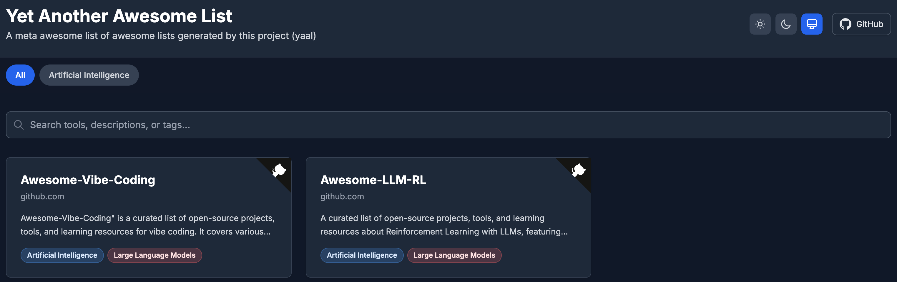

# Yet Another Awesome List

A site engine for Awesome Lists, and a meta index of Awesome List repositories generated by this project (yaal). It is not a general directory of arbitrary awesome lists.

🌐 **Live Website**: [https://0xWelt.github.io/yaal/](https://0xWelt.github.io/yaal/)

## Table of Contents

- [Table of Contents](#table-of-contents)
- [Scope](#scope)
- [Artificial Intelligence](#artificial-intelligence)
  - [Large Language Models](#large-language-models)
    - [Awesome-LLM-RL](#awesome-llm-rl)
  - [AI Agents](#ai-agents)
    - [Awesome-Agent-Ecosystem](#awesome-agent-ecosystem)
- [Repo Status](#repo-status)
- [Contributors](#contributors)
- [Star History](#star-history)
- [License](#license)

## Scope

This repository's README is the source of the public index. yaal maintains only Awesome List repositories generated by yaal: a nested yaal git submodule, a yaal.config.yaml, and a yaal-built site (typically GitHub Pages). Product entries belong in those instance lists, not here. Do not add a repository merely because it is an awesome list. Third-party directories that do not use yaal to generate their site are out of scope. Retired or merged lists (Awesome-Vibe-Coding, Awesome-Personal-Agents, Awesome-Agent-Services) are not listed and should not be re-added.

## Artificial Intelligence

> Curated collection of AI-related awesome lists covering artificial intelligence tools, resources, and learning materials.

### Large Language Models

> Resources and tools specifically focused on large language models.

#### [Awesome-LLM-RL](https://github.com/0xWelt/Awesome-LLM-RL)

A curated list of open-source projects, tools, and learning resources about Reinforcement Learning with LLMs, featuring frameworks like OpenRLHF built on Ray, vLLM, ZeRO-3 and HuggingFace Transformers.

<!-- image: https://raw.githubusercontent.com/0xWelt/Awesome-LLM-RL/main/docs/Awesome-LLM-RL.png -->

### AI Agents

> Curated collections of AI agent frameworks, tools, and platforms.

#### [Awesome-Agent-Ecosystem](https://github.com/0xWelt/Awesome-Agent-Ecosystem)

A curated list of terminal products, the services agents call, the models that drive them, and open standards. Live site: https://0xwelt.github.io/Awesome-Agent-Ecosystem/

<!-- image: https://raw.githubusercontent.com/0xWelt/Awesome-Agent-Ecosystem/main/docs/Awesome-Agent-Ecosystem.png -->

## Repo Status

## Contributors

This project exists thanks to all the people who contribute.

## Star History

## License

This work is licensed under a
[Creative Commons Attribution 4.0 International License](http://creativecommons.org/licenses/by/4.0/).
